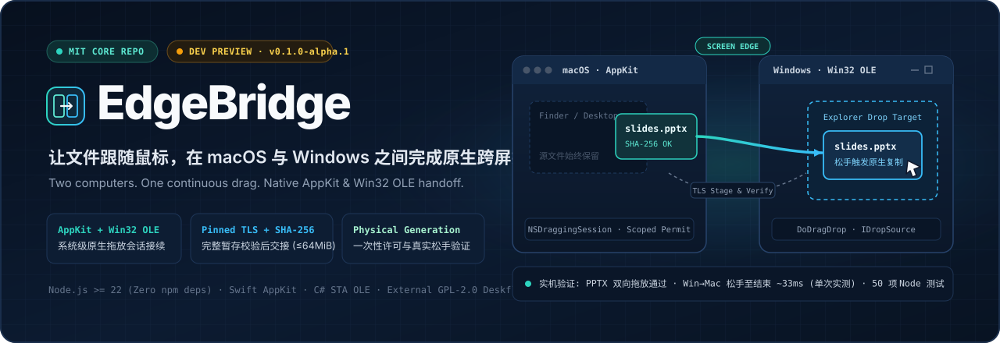
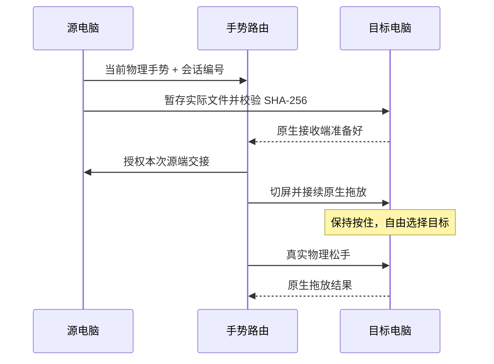

<p align="center"></p>
<p align="center">
  <a href="https://github.com/qwe12yuh/EdgeBridge/actions/workflows/ci.yml"></a>
  <a href="LICENSE"></a>
  
  
  
</p>

**让文件跟着鼠标，从一台电脑拖到另一台。**

EdgeBridge 是独立编写的 MIT 项目，通过受控的鼠标手势交接、经过校验的文件传输和系统原生拖放，在 macOS 与 Windows 之间接续一次按住、跨屏、选目标、松手的动作。

[快速开始](#快速开始) · [开发者接入](docs/SETUP.md) · [实测与限制](VALIDATION.md) · [协议设计](GESTURE-LAB.md) · [贡献](CONTRIBUTING.md)

## 已经做到什么

| 能力 | 当前状态 |
| --- | --- |
| Windows → Mac 原生拖放 | 普通 PPT 实机通过，用户确认流畅；松手到原生结束约 33ms（单次实测） |
| Mac → Windows 原生拖放 | 同一普通 PPT 回拖实机成功 |
| 内容传输 | 固定证书 TLS、配对令牌、路径检查、SHA-256 校验 |
| 接收位置 | 系统原生桌面或文件夹，暂存成功与实际落地分别验证 |
| 中文文件名、文件夹、空目录 | 传输层自动测试覆盖；原生界面更多组合仍待验证 |
| 普通键鼠共享 | 配合单独的 Deskflow 实验适配器；不替换原版安装 |

> **开发者预览，尚不是一键安装产品。** 跨屏手势需要独立的 GPL Deskflow 适配器、双端原生程序及手动配对。当前先完整暂存再交接，手势单批上限 **64MiB**；尚未实现大文件按需流式拖放，也不会自动删除源文件。这里的成功范围是已记录的实机测试，不代表任意应用和文件组合都已通过。

## 快速开始

先独立验证传输层。需要 Node.js 22+ 与 OpenSSL，无第三方 npm 依赖。

```sh
npm test
node src/cli.mjs init .state
node src/cli.mjs serve .state/receiver.local.json
```

另开终端，发送一个现有文件：

```sh
node src/cli.mjs send .state/peer.local.json /absolute/path/to/example.txt
```

结果保存在 `.state/inbox/incoming-*/`。这一步验证完整复制，**不会启动跨屏手势**。证书、密钥与配对文件仅留在本机，不能提交到仓库。

要接入真实跨屏拖放，请阅读 [双机开发部署](docs/SETUP.md)。默认仅监听 loopback，当前验证部署通过 SSH 隧道连接两台电脑，TLS 校验始终开启。不添加开机自启或公共防火墙规则。

## 工作方式



Mac 接收端的系统按下须经过一次性许可、物理手势代号、截止时间和实际目标进程/窗口检查。提前松手、迟到或重放许可不能启动新拖动。文件上传、原生接受和目标文件验证是不同阶段。

## 项目结构

```text
src/             文件传输、控制通道、手势状态机
native/macos/    AppKit 手势接收与边缘捕获
native/windows/  OLE 手势接收与边缘捕获
scripts/         本地构建与自检
examples/        不含配对材料的配置说明
test/            Node 协议、传输与生命周期测试
docs/            接入、已知问题与项目视觉资源
```

目前通过 **50 项 Node 测试**，并完成 macOS/Windows 原生构建和自检、独立 GPL 适配器的 7 项相关回归。实机证据与测试边界见 [VALIDATION.md](VALIDATION.md)。Windows 较晚的结束回执仍可能被错误记录成取消，详见 [已知问题](docs/KNOWN-ISSUES.md)。

## 许可与依赖

本仓库的独立源码采用 [MIT](LICENSE)。参考项目的 GPL 源码、修改补丁和二进制不包含在本仓库。

跨屏模式还需要单独维护的 **[Deskflow 适配器](https://github.com/qwe12yuh/EdgeBridge-Deskflow-Adapter)**，其补丁保留上游 GPL-2.0-only 与 OpenSSL exception，不能当作本项目的 MIT 源码重新授权。其构建、对应源码和分发说明以适配器仓库为准。

使用公开的 [Apple AppKit](https://developer.apple.com/documentation/appkit/nsdraggingsource)、[Microsoft OLE](https://learn.microsoft.com/en-us/windows/win32/api/ole2/nf-ole2-dodragdrop) 和 [Node.js HTTPS](https://nodejs.org/api/https.html) API。
