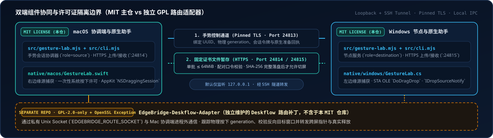
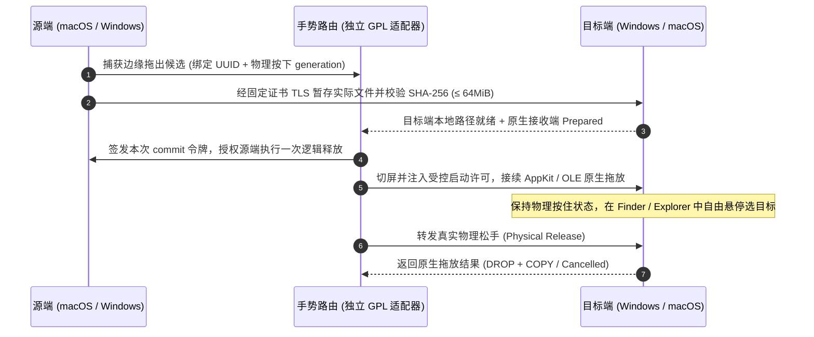

<p align="center">
  
</p>

<p align="center">
  <a href="https://github.com/qwe12yuh/EdgeBridge/actions/workflows/ci.yml"></a>
  <a href="LICENSE"></a>
  
  
  = 22" src="https://img.shields.io/badge/node-%3E%3D22-34d399">
</p>

<p align="center">
  <a href="#解决什么问题">项目定位</a> ·
  <a href="#已经做到什么">实测状态</a> ·
  <a href="#工作原理与架构边界">工作原理</a> ·
  <a href="#快速开始">快速开始</a> ·
  <a href="docs/DASHBOARD.md">本地控制台</a> ·
  <a href="#当前限制与已知问题">已知限制</a> ·
  <a href="docs/SETUP.md">双机部署</a> ·
  <a href="VALIDATION.md">验证记录</a> ·
  <a href="#许可证与组件边界">许可证边界</a>
</p>

<p align="center">
  <a href="docs/AGENT-INSTALL.md"><strong>⚡ Agent 一键安装入口</strong></a>
  · <a href="https://raw.githubusercontent.com/qwe12yuh/EdgeBridge/main/docs/AGENT-INSTALL.md">复制给 Agent 的安装链接</a>
</p>

---

## 解决什么问题

软件键鼠共享工具（如 Deskflow）可以让鼠标指针在两台电脑之间自由移动，但当你在 macOS Finder 或 Windows Explorer 中**按住一个文件拖向屏幕边缘**时，系统的原生拖放会话会被困在源操作系统内，无法随鼠标跨越屏幕边界。

**EdgeBridge** 是一个独立编写的 **MIT** 开源项目，用于在 macOS 与 Windows 之间接续一次完整的物理拖放手势。它将“**按住文件 → 移出屏幕边缘 → 在目标电脑悬停选位置 → 真实物理松手**”拆解并桥接为三个受控阶段：

1. **固定证书文件暂存**：通过内置 HTTPS（Pinned TLS + 配对令牌 + `SHA-256` 校验）将所选文件安全暂存至目标机私有目录；
2. **物理手势代次路由**：配合单独维护的 **[Deskflow 路由适配器](https://github.com/qwe12yuh/EdgeBridge-Deskflow-Adapter)**（`GPL-2.0-only WITH LicenseRef-OpenSSL-Exception`），跟踪同一次物理按下代次（generation）与边缘切屏状态；
3. **系统级原生拖放接续**：在目标端启动真实的 macOS `AppKit`（`NSDraggingSession`）或 Windows `Win32 OLE`（`DoDragDrop` / `IDropSource`）原生拖放会话，直至用户真实松手完成落地。

---

## 已经做到什么

| 能力维度 | 当前状态与实机验证结果 |
| :--- | :--- |
| **Windows → macOS 跨屏拖放** | 普通 PPT 文件（`.pptx`，`202,615` 字节）实机人工验证通过；松手前共触发 68 次 AppKit 移动回调，光标持续平滑跟随。**物理松手到 AppKit 原生 `COPY` 结束约 `33ms`**（注：该数值为单次实机实测结果，并非普遍延迟保证）。 |
| **macOS → Windows 跨屏拖放** | 同一普通 PPT 文件从 Mac 回拖至 Windows 实机人工验证成功，Windows OLE 返回 `DROP + COPY` 且落盘文件哈希一致（注：当前存在迟到回执可能被协调器日志误记为取消的已知时序问题，详见[当前限制](#当前限制与已知问题)）。 |
| **内容传输与完整性校验** | 零第三方 npm 依赖，基于 Node.js HTTPS 实现固定证书 TLS、配对口令认证、路径边界检查与 `SHA-256` 校验；文件完整暂存校验后才允许切屏交接。 |
| **源文件保护与落点语义** | 始终采用**复制语义**，不移动或删除源文件；接收端暂存成功与 Finder / Explorer 最终落盘分别独立验证，同名冲突处理交由目标操作系统原生控制。 |
| **中文文件名与目录传输** | 传输层自动化测试已覆盖 Unicode/中文路径、多文件、嵌套目录与空目录；原生 UI 层的更多交互组合仍在逐步验收。 |
| **自动化测试与 CI 检查** | 主仓库 **53 项 Node.js 测试**、macOS/Windows 原生编译与自检、独立 GPL 适配器的 **7 项路由回归测试**，以及 **3 项 GitHub Actions CI 检查**（Ubuntu 传输层测试 + macOS/Windows 原生编译自检）均已通过。 |

> [!IMPORTANT]
> **关于自动化测试与实机验收的边界声明**
> 53 项 Node 测试与 3 项 GitHub CI 检查仅证明传输协议、TLS 证书固定、会话令牌生命周期及原生辅助程序基础编译/自检通过，**不能等同于所有桌面交互场景均已验收**。跨屏拖放的真实可用性以 [VALIDATION.md](VALIDATION.md) 中逐项记录的人工实机测试为准。

---

## 工作原理与架构边界

<p align="center">
  
</p>

在一次跨屏拖放中，源端捕获、文件暂存、切屏路由与目标端原生拖放严格按会话上下文绑定推进：



### 核心安全与状态门禁

- **候选租约与单次源端释放**：Mac 右边缘与 Windows 左边缘仅在当前物理按下租约内响应拖出动作，日常普通点击直接穿透。源端仅在收到匹配的本次 `commit` 令牌后才执行一次本地逻辑松手。
- **macOS 反向受控启动许可（Scoped Permit）**：Windows → Mac 方向启动系统拖放前，须申请一次性许可，严格绑定目标 `PID`、窗口 ID、物理 `generation`、`300ms` 截止时间与随机 `nonce`。提前松手、超时、窗口不符或重放许可均无法启动新拖放。
- **阶段严格区分**：文件上传至暂存区（Staging）、原生拖放循环运行（`drag-loop-running`）、物理按键释放与最终目标文件夹落地是完全独立的验证阶段，任何中途取消或断线都会立即中止当前会话，不会静默落入错误位置。

完整状态机与失败复盘请参阅 [GESTURE-LAB.md](GESTURE-LAB.md) 与 [FAILURE-ANALYSIS.md](FAILURE-ANALYSIS.md)。

---

## 快速开始

用 Codex、Claude Code 或其他能操作终端的本地 Agent 安装时，复制这条指令给它：

```text
请在我的 Mac 和 Windows 上安装并验证 EdgeBridge。按这份指南执行：https://raw.githubusercontent.com/qwe12yuh/EdgeBridge/main/docs/AGENT-INSTALL.md
```

Agent 可以接手构建、配对和预检；切换正在使用的 Deskflow、授予 macOS 辅助功能权限以及最后的跨屏拖放验收，仍需要你参与。也可以按下文手动部署。

### 1. 单机验证传输层（无需双机与适配器）

只需 **Node.js 22+** 与 **OpenSSL**（无任何第三方 npm 依赖），即可在单机验证固定证书 TLS 传输与 `SHA-256` 校验流程：

```sh
# 1. 运行协议与传输层单元测试
npm test

# 2. 初始化本地测试证书、私钥与配对配置
node src/cli.mjs init .state

# 3. 静态校验接收端与发送端配置（校验字段、证书有效期、私钥匹配性并输出指纹）
node src/cli.mjs check .state/receiver.local.json
node src/cli.mjs check .state/peer.local.json

# 4. 启动本地 HTTPS 接收端
node src/cli.mjs serve .state/receiver.local.json
```

另开一个终端窗口，发送任意本地文件：

```sh
node src/cli.mjs send .state/peer.local.json /absolute/path/to/example.txt
```

校验通过的文件将保存在 `.state/inbox/incoming-*/` 下。**此步骤仅验证加密传输与完整性校验，不会启动跨屏鼠标手势。** 生成的证书、私钥与 `*.local.json` 配对材料仅限本机私有目录使用，切勿提交到 Git 仓库。

### 2. 双机跨屏原生拖放部署（开发者预览）

完整跨屏手势需要一台 macOS 与一台 Windows 电脑、双端原生辅助程序以及独立维护的 GPL Deskflow 适配器。当前验证环境默认仅监听 `127.0.0.1`，通过 SSH 隧道转发控制与传输端口，并全程保持 TLS 证书固定校验：

1. **构建双端原生辅助程序**：在 macOS 编译 `GestureLab.swift`（需授予辅助功能权限）并运行 `--self-test`；在 Windows 编译 `GestureLab.cs` 并运行 `--self-test`。
2. **构建独立 GPL 路由适配器**：按照 [EdgeBridge-Deskflow-Adapter](https://github.com/qwe12yuh/EdgeBridge-Deskflow-Adapter) 说明，基于 Deskflow `v1.27.0` 打补丁并编译隔离运行的 `deskflow-core`。
3. **生成双端配对配置并建立 SSH 隧道**：在仓库外运行 `node src/cli.mjs init-lab <私有空目录> <Mac名称> <Windows名称>` 生成配对好的 `mac/` 与 `windows/` 证书及配置包（字段说明见 [examples/README.md](examples/README.md)），使用 `node src/gesture-lab.mjs --check <config.local.json>` 预检无误后，转发 `24813`（控制）、`24814`（Mac 接收）与 `24815`（Windows 接收）端口。
4. **按序启动会话**：启动带 `EDGEBRIDGE_ROUTE_SOCKET` 的隔离 `deskflow-core` → 启动 Windows `gesture-lab.mjs` → 启动 Mac `gesture-lab.mjs` → 启动 Mac 手势 App。

完整命令、环境变量与验收步骤请直接阅读 **[双机开发部署指南 (`docs/SETUP.md`)](docs/SETUP.md)**。

---

## 当前限制与已知问题

> [!WARNING]
> **当前版本为 `0.1.0-alpha.1` 开发者预览，尚不是面向普通用户的一键安装产品。** 在接入或评估前，请务必了解以下真实限制：

- **需手动部署，无安装器或开机自启**：当前仅提供源码发布，**没有一键安装程序、正式代码签名安装包、局域网自动发现或开机自启服务**。双端编译、TLS 证书配对、SSH 隧道建立及实验停止后的原版 Deskflow 恢复均需手动管理。
- **先完整暂存再交接，手势单批上限 64 MiB**：跨屏手势目前必须在文件完整暂存至目标端并通过 `SHA-256` 校验后才允许切屏交接，单批上限为 **64 MiB**（`67,108,864` 字节）；**尚未实现大文件按需流式拖放（File Promise / Virtual Stream）**。
- **Windows 迟到回执误记取消（已拆分两阶段释放，待实机复测消项）**：在早期 Mac → Windows 回拖实测中，若 Windows OLE 目标应用处理耗时超过 2 秒完成等待窗口，协调器日志可能先误记为 `cancelled`，随后才收到原生的 `DROP + COPY` 成功回执（实机测试中文件已实际复制成功）。现已在代码与单测中将“OLE 消费物理释放（`drop-released`，立即通知路由器 `finish`）”与“目标应用复制完成（`finishTimeout` + `late-result`）”拆分为两阶段，待下一轮双机慢目标实机复测确认后正式消项，详见 [docs/KNOWN-ISSUES.md](docs/KNOWN-ISSUES.md)。
- **实测覆盖范围有限**：目前人工实测通过的是固定布局（Mac 在左、Windows 在右）下的普通 PPT 单文件双向跨屏拖放；多文件/文件夹连续交互拖放、快速甩动释放、中途频繁切换目标应用及断线重连等场景仍待进一步回归验证。

---

## 项目结构与文档导航

```text
EdgeBridge/
├── src/             Node.js 文件传输 (Pinned TLS)、控制通道与跨屏手势状态机
├── native/
│   ├── macos/       Swift / AppKit 右边缘源捕获与受控反向拖放接收端
│   └── windows/     C# / Win32 STA OLE 左边缘源捕获与 IDropSource 接收端
├── scripts/         macOS 与 Windows 本地编译、启动器构建及自检脚本
├── examples/        不含密钥与配对凭证的双机配置模板 (mac / windows)
├── test/            53 项 Node.js 协议、传输、证书固定与会话生命周期测试
└── docs/            部署指南、已知问题说明与 SVG 视觉资源
```

| 文档 | 内容说明 |
| :--- | :--- |
| **[docs/AGENT-INSTALL.md](docs/AGENT-INSTALL.md)** | 可直接交给本地 Agent 的安装、验收与恢复流程 |
| **[docs/DASHBOARD.md](docs/DASHBOARD.md)** | 在 Mac 上查看双机连接状态、启动和停止已部署的协同环境 |
| **[docs/SETUP.md](docs/SETUP.md)** | 双机开发部署、原生程序构建、SSH 隧道与隔离路由接入指南 |
| **[VALIDATION.md](VALIDATION.md)** | 2026-11-16–17 自动化测试、原生自检与双向 PPT 实机验收详细记录 |
| **[docs/KNOWN-ISSUES.md](docs/KNOWN-ISSUES.md)** | Windows 迟到回执误报、64 MiB 暂存上限及待验收交互清单 |
| **[GESTURE-LAB.md](GESTURE-LAB.md)** | 双向原生拖放协议状态机、Mac 受控系统按下许可与验收标准 |
| **[FAILURE-ANALYSIS.md](FAILURE-ANALYSIS.md)** | 早期原型在合成事件、App 内派发与跨屏时序上的失败分析记录 |
| **[examples/README.md](examples/README.md)** | `mac.example.json` 与 `windows.example.json` 字段说明 |
| **[CHANGELOG.md](CHANGELOG.md)** | 版本变更记录（`0.1.0-alpha.1`） |
| **[CONTRIBUTING.md](CONTRIBUTING.md)** | 贡献规范、许可证净室要求与验证准则 |

---

## 许可证与组件边界

EdgeBridge 采用清晰的**双仓库、双许可证隔离架构**，严格区分独立 MIT 代码与上游 GPL 衍生补丁：

| 仓库 | 许可证 | 职责与代码边界 |
| :--- | :--- | :--- |
| **[EdgeBridge](https://github.com/qwe12yuh/EdgeBridge)**（本仓库） | **[MIT License](LICENSE)** | 全部由作者独立编写，包含 Node.js 加密文件传输、手势控制协调器以及 macOS AppKit / Windows OLE 原生辅助程序。**本仓库不包含任何 GPL 源码、修改补丁或二进制文件。** |
| **[EdgeBridge-Deskflow-Adapter](https://github.com/qwe12yuh/EdgeBridge-Deskflow-Adapter)**（独立仓库） | **`GPL-2.0-only WITH LicenseRef-OpenSSL-Exception`** | 跨屏模式所依赖的 Deskflow 路由补丁，独立维护与分发，通过本地私有 Unix Socket（`EDGEBRIDGE_ROUTE_SOCKET`）与 EdgeBridge 进程外通信。**该适配器保留上游 GPLv2 与 OpenSSL 例外条款，不属于 MIT 代码，不得按 MIT 重新授权。** |

底层系统交互仅调用公开文档化的 [Apple AppKit (`NSDraggingSession`)](https://developer.apple.com/documentation/appkit/nsdraggingsource)、[Microsoft Win32 OLE (`DoDragDrop`)](https://learn.microsoft.com/en-us/windows/win32/api/ole2/nf-ole2-dodragdrop) 与 [Node.js `https`](https://nodejs.org/api/https.html) 接口。
